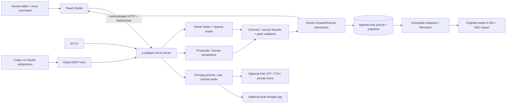

# Shared editing architecture

The server is the only project writer. A successful patch renews its lease; stale revisions and ended turns are rejected. Human selection constrains anchored agent edits. Three-way merges use stable IDs when reverting historical edits or accepting proposals after unrelated changes. Conflicting changes require review.

External text is untrusted data. Scope checks, protected source paths and explicit human executable-pack trust provide enforcement beyond prompt instructions. This is a local single-user application; it is not a sandbox for arbitrary third-party code. Trusted pack code runs locally only after explicit trust, validation and a pinned content receipt.

Cloud providers receive requested text/audio. Originals, cached takes and history remain in the local project directory. Browser speech synthesis is temporary preview playback and never silently becomes exported narration.
