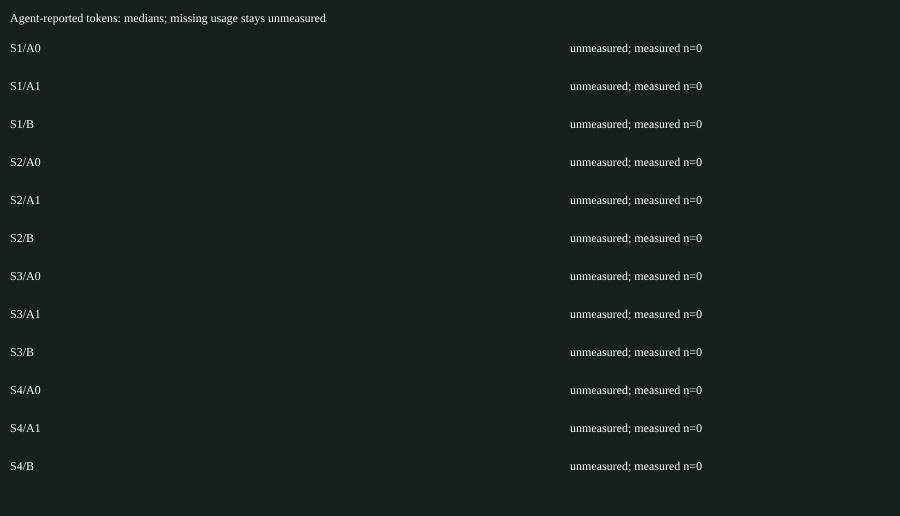

# Update 4 verification results — 28 October 2026

**Release: NO_GO.** The core harness is implemented: **200 tests across 35 files** and **39 browser checks across three repetitions** pass. Typecheck, build and packaged MCP smoke pass. The real-agent comparison is incomplete; it establishes no token, cost or quality advantage.

The frozen experiment used Codex 0.162.1, model gpt-6.1-sol, low reasoning, a 120-second common active budget and three scheduled repetitions per scenario/arm. Measured source revision: `0885a9c`. Prompts, budgets and target criteria were not tuned from valid arm results. See [method and limitations](UPDATE4.md) and [the complete checklist](../VERIFICATION.md).

| Outcome | Scheduled slots |
| --- | ---: |
| Valid environment; agent deadline exceeded | 4 (three S1/A0, one S1/B) |
| Provider usage limit; invalid/unmeasured | 20 |
| A1 original-guidance license/vetting block | 12 |
| Total | 36 |

A scheduled slot is not a successful model run. All complete-session token/cost comparisons are unmeasured. The four valid attempts were deadline-censored and did not complete the scripted feedback. Acceptance rate is zero for those attempts; output aesthetics are unknown. Later quota refusals and quarantined arms are excluded from measured statistics. The runner now stops further model launches after the first provider-wide quota error and refuses to append a new experiment into an existing results directory.

A1's original `remotion-dev/skills` pin `30d4553ecd46fbc5212fd0ff006ae43af522158b` has no original license file and remains disabled with zero ingestion. Remocn, onda, snapcn and remotion-templates also remain quarantined under the owner's policy. No written source override was inferred.

| Scenario/arm | Valid/scheduled slots | Pass rate | Tokens median (range) | Wall ms median (range) |
| --- | --- | --- | --- | --- |
| S1/A0 | 3/3 | 0 | n/a (n/a–n/a) | 120042 (120022–120052) |
| S1/A1 | 0/3 | n/a | n/a (n/a–n/a) | n/a (n/a–n/a) |
| S1/B | 1/3 | 0 | n/a (n/a–n/a) | 120026 (120026–120026) |
| S2/A0 | 0/3 | n/a | n/a (n/a–n/a) | n/a (n/a–n/a) |
| S2/A1 | 0/3 | n/a | n/a (n/a–n/a) | n/a (n/a–n/a) |
| S2/B | 0/3 | n/a | n/a (n/a–n/a) | n/a (n/a–n/a) |
| S3/A0 | 0/3 | n/a | n/a (n/a–n/a) | n/a (n/a–n/a) |
| S3/A1 | 0/3 | n/a | n/a (n/a–n/a) | n/a (n/a–n/a) |
| S3/B | 0/3 | n/a | n/a (n/a–n/a) | n/a (n/a–n/a) |
| S4/A0 | 0/3 | n/a | n/a (n/a–n/a) | n/a (n/a–n/a) |
| S4/A1 | 0/3 | n/a | n/a (n/a–n/a) | n/a (n/a–n/a) |
| S4/B | 0/3 | n/a | n/a (n/a–n/a) | n/a (n/a–n/a) |

Local, ignored evidence:

- [Original immutable result records](../.clipkit/update4/results/results.jsonl), [frozen protocol](../.clipkit/update4/results/frozen-protocol.json), [score/report summary](../.clipkit/update4/results/summary.json) and [release gate](../.clipkit/update4/results/release-gate.json).
- [Replay proof](../.clipkit/update4/results/replay-proof.json): nine actual failed-Studio revisions replayed after ZIP extraction, with valid anonymized hashes and project schemas, without an agent/provider. This is local evidence; independent person/machine reproduction is pending.
- [Trace alias index](../.clipkit/update4/results/derived-traces.json): nested Studio recorders copied into standard CLI-discoverable paths. Original results and revision records are retained. Expired local capability strings were removed from older transcripts with audited before/after hashes in `.clipkit/update4/historical-redaction.json`. Use `ck replay RUN_ID-studio --root .clipkit/update4/results`.
- [Redacted actual trace ZIP](../.clipkit/update4/results/.clipkit/exports/codex-S1-B-r0-a0-93517e2b-studio-trace.zip) and [minimal selected-layer repro](../.clipkit/update4/results/.clipkit/exports/codex-S1-B-r0-a0-93517e2b-studio-repro-trace.zip).
- Browser screenshots and console/network/API receipts are in `test-results/`; failed setup/driver evidence remains under `.clipkit/update4/preflight-invalid-*`, `browser-pre-canonical-hash/` and `browser-pre-color-blur/`.

The initial matrix predates explicit parent-exit/signal receipts and failure-output retention; its records are not rewritten to invent these. New runner attempts retain valid generated result.mp4 artifacts outside trace ZIPs on failure and keep partial usage separate. Arbitrary workspace snapshots are rejected by the synthetic recorder.

Remaining acceptance includes exhaustive legacy CLI/MCP output/parity contracts, dedicated S5–S15 agent drivers, full independent output/OCR/cut/caption/scope evaluation, consented real speech/voice fixtures, live-provider demos, human A/B ratings, timed independent playbook study and independent reproduction. Cross-platform/agent/Node matrix is deferred. See the checklist for the exact implemented/partial/pending distinctions. Passing local tests does not waive these requirements.
