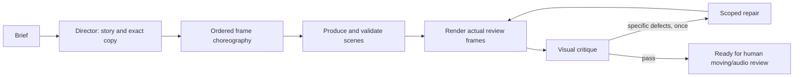

# Video direction, generation and editing

## Why the previous loop produced weak films

The old loop asked a coding agent to publish valid TSX. It reduced Video Forge's direction/review process to a small helper vocabulary, and its demo repeatedly used headline-and-background staging. Compilation, deterministic pixels and a successful MP4 are engineering checks; they do not establish taste, continuity or meaningful motion.

The new loop makes a film treatment and actual pixels part of the workflow. Website motion supplies a vocabulary, not a replacement for story. The original Video Forge reference was inspected locally for varied composition, spatial traversal, editorial objects and readable landings. Its pixels/private production captures are not bundled. A new original spatial study supplies the plugin's reusable visual reference.

Story and choreography are separate validated commits in **one director invocation**. This removes an unnecessary model handoff. The producer cannot start until both exist. A director proposes two distinct visual territories, chooses one, and commits continuous frame-bounded beats with exact copy, purpose and evidence. Choreography adds subjects, composition, entry/exit, shared-object continuity, reading holds, sound cues and ordered key poses. This describes frame intervals and interpolation intentions; it does not waste context enumerating every frame.

The producer interprets this as direction, not a fixed layout. The critic receives actual rendered contact sheets and can inspect individual frames. It must open the images before submitting a verdict, identify concrete frame-bounded defects, and cannot edit source. At most one automatic repair follows. Remaining defects produce `needs-review`, never a fabricated success.

**Editing has a shorter, different loop:** render the selected passage → diagnose the smallest correction → edit → render/critique → optional repair. A property change can reuse supplied props without loading source or redesigning the film. Outside frames, source phase and measured dialogue/captions remain protected. Passing feedback is resolved through an agent-attributed transaction after review.

## Website-like motion as video-native TSX

The kit includes pinned MIT Motion Primitives source and seekable adaptations of TextEffect, TextMorph and AnimatedGroup, plus original ScrollTunnel, GradientBlinds and TrailType. Source and license notices are retained. They use explicit frame progress instead of browser animation history, scrolling, hover, timers or requestAnimationFrame. Existing depth planes, masks and the frame-driven Paper shader remain available.

React Bits is a visual reference. Its current license restricts redistribution of components/ports, so its components are not bundled as a ClipKit asset pack. Motion Primitives provides actual permissively licensed source adaptations. Codrops/Motion references inform mechanisms; their documentation/media are not represented as bundled assets.

The Motion panel has 14 mechanism studies, including six website-style examples. These are direction mechanisms, not 14 compulsory scene layouts or stock clips. `motion_reference` provides an original visual composition study to the director and producer.

## Invocation and efficiency

- `ck video generate --brief-file brief.txt --duration 15 --pacing fast` starts the reviewed generation pipeline. `ck video status` reports real stages, verdicts and per-stage usage. `ck video cancel` stops later stages/publication.
- Add `--draft` to skip model critique. The result is explicitly `needs-review`. `ck video review` finishes an existing draft without rewriting its direction first.
- `--reuse-direction` skips planning only when brief, frame range, FPS, pacing and validated choreography match. Changed timing/copy invalidates reuse.
- `ck video edit --brief-file feedback.txt --comment COMMENT_ID` uses the editorial loop and the saved scope.
- MCP exposes the same high-level operations. Start `video_run` before acquiring a manual editing lease. App stages use restricted profiles; they cannot start nested pipelines.
- Direction plans and scene source are paged. Chapter/transcript windows and affected-layer props replace whole-project context dumps. Tool families differ by role; the critic receives images and review tools, not source mutation tools.

Reviewed generation is a quality tradeoff, **not guaranteed cheaper or faster than one plain code-generation call**. Actual provider usage is reported separately from estimated incremental text payload. Image encoding and provider base context are not estimated by dividing JSON bytes by four.

## Long form

Requests longer than 180 seconds first produce a narrative/chapter outline. Stable chapters cover the requested budget continuously; each production section is at most 180 seconds. The application reports `planned` and asks the user to select a chapter to produce. It does not claim an outlined hour is a generated film.

Each selected chapter then receives its own direction, generation and review. Unchanged chapters and immutable scene artifacts are reused. The schema limit is 108,000 frames (one hour at 30 fps); hour-long generation/render performance remains unbenchmarked.

## Review limits and data

Representative stills can expose framing, overlap, repeated staging and transition poses. They do not prove every intervening frame, motion feel, precise sound synchronization or audio quality. Review moving playback at phone size, with sound and muted, before final delivery.

Selected source/properties, relevant story text/transcript windows and rendered review/reference images are sent to the selected coding agent. Localhost remains local; the authenticated model/provider receives the supplied context. Provider keys and live server tokens are excluded from exported projects and Git.

For source choreography in a chapter, convert absolute plan key poses to source-local frames by subtracting the plan's fixed `startFrame`. `useCurrentFrame()` already includes source phase during scoped segments. Adding a split item's current `at` again would double-offset its animation; use the source-local clock.

The managed Codex subprocess disables unrelated command, app/plugin, browser/computer and subagent features for that invocation while retaining the explicit ClipKit MCP server. This is per-process configuration, not an uninstall or global preference change. Supported feature controls were checked against the [official configuration reference](https://learn.chatgpt.com/docs/config-file/config-reference). Mutation replies omit durable forward/inverse journals; explicit history remains available. The scalar scene-property schema is fully described in the MCP contract to avoid costly malformed-schema retries. These changes were applied after the A/B film runs; no unmeasured token reduction is claimed.

All phase transactions belonging to one video request share a logical history group, so undoing the latest agent request restores its direction, source changes and feedback metadata together. Stage leases and request-ID namespaces remain separate; grouping does not authorize late writes from an expired stage.
